# H ZIP 사진 검토 후보30장

7개 ZIP의700장을 모두 시각 검토한 뒤 고른 H 선별용 후보30장이다. 기존 H 공개사진10장을 다시 이름 붙인 자료가 아니다. 최종10장·팀 인수30건·독립 사람 정답·현장 자료 인수와 구분한다.

700장은20장씩35개 연락판으로 확인했고59개 원본을 더 크게 보았다. 별도 리드가 원본 항목·CSV SHA·출처의700행 일치/누락0을 대조했으며, 게시용30장 화면도 각각 확인했다. 썸네일 전수 검토는700장 모두의 원본 해상도 개인정보·진위 감정을 뜻하지 않는다.

## 선정 기준과 분포

중소 제조업 폐플라스틱이라는 프로젝트 범위에서 사진의 형태·분리 상태·부착물·정보 누락이 어떤 질문/보류를 유발하는지로 골랐다. 비슷한 타이어나 골재 사진을 숫자에 맞춰 채우지 않았으며, 다른 재료는 명시적 대비·보류 역할로 구분했다. 순위는 검토 유용성의 편집상 순서이며 과학적 정확도나 권리 허가 점수가 아니다.

| 원본 ZIP 분류 | 검토 | 선정 |
| --- | ---: | ---: |
| 01-plastic |100|13|
| 02-metal |100|3|
| 03-wood |100|2|
| 04-packaging |100|7|
| 05-sludge |100|2|
| 06-rubber |100|2|
| 07-construction |100|1|
| 합계 |700|30|

## 출처와 사용조건

**30장 모두 원본 CSV의 재사용허락·촬영진위가 미확인이다. 사진별 허락이나 현장 진위를 확보했다고 표시하지 않는다.** 원문의 재활용·재질 설명, 공개 노출, 사이트 아이콘/코드 라이선스도 사진의 이용 허락이나 성분 검증을 대신하지 않는다. 소유자가 요청한 비공개 GitHub 검토 게시 범위와 사진 저작자의 권리는 별개다.

`packaging_021` 원문에는 무단 전재/재배포 제한이 있고, WEIMA·FM·US Belt 등의 관련 문구도 사진별 기록에 남겼다. 현재 허락을 확보한 묶음이나 외부 발표/학습/무제한 재배포용 데이터셋으로 부르지 않는다. 상세 권리·접근 한계와 출처 주장은 `manifest.json`의 각 항목에 있다. 원문 접근403·리다이렉트·희박한 권리 정보도 성공/허락으로 바꾸지 않았다.

기존 `data/photo-archives/`의 원본 ZIP 제외·최소 목록은 그대로 유지했다. 여기에는 요청에 따른 선별30장과 해당30장의 근거만 담는다. 원본 ZIP·전체700행 CSV·인증정보·개인 로컬 경로는 포함하지 않는다.

사진은 전체 프레임의 비율을 유지해1200×900 안의 크기로 조정한 뒤 기존 H sanitizer로 디코딩·메타데이터 제거·PNG 재인코딩했다. 작은 원본도 이 범위 안으로 조정될 수 있으며 원본에 없던 세부 정보가 생겼다는 뜻은 아니다. 보이는 상표/워터마크를 삭제하거나 재질 증거를 합성하지 않았다. 원본과 게시본의 SHA는 별도로 기록했다. 이미지에서 국가/사업장·질량·촬영 진위·수지·오염 없음·유해성·법적 코드·처리 가능성을 확정하지 않는다.

## 사진과 개별 선정 근거

### 01 plastic_003

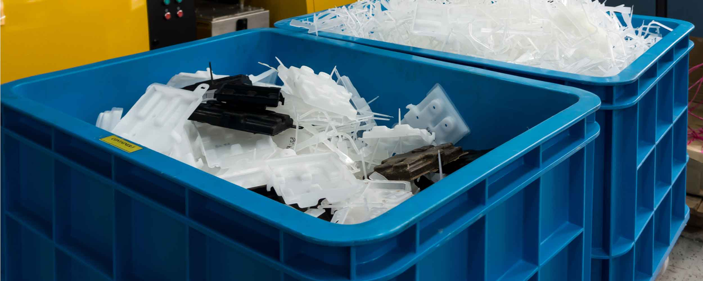

선정 이유: 흰색·검은색 성형품과 가지형 조각이 함께 있어 수지·등급 및 색상별 분리 여부를 묻기 좋다.

역할: production scrap: segregation and grade confirmation

보이는 관찰: Blue totes contain white branching runners, white molded pieces and some black pieces.

원본: `01_plastic_100.zip` / `폐플라스틱/plastic_003.jpg`. 원본 SHA-256: `b247b22390be695b94c07a04fd606270ceea1511c0224a612483f7edffdb3b41`.

출처 제목은 원문 주장이다: Injection Molding Scrap Collection. 출처: `https://shibaura-machine.com/articles/im-2022-01-12-looking-to-reduce-scrap-why-all-electric-injection-molding-machines-are-the-clear-choice/`.

재사용허락/촬영진위: 미확인. No image reuse license established in extracted primary text and inspected HTML matches.

### 02 plastic_020

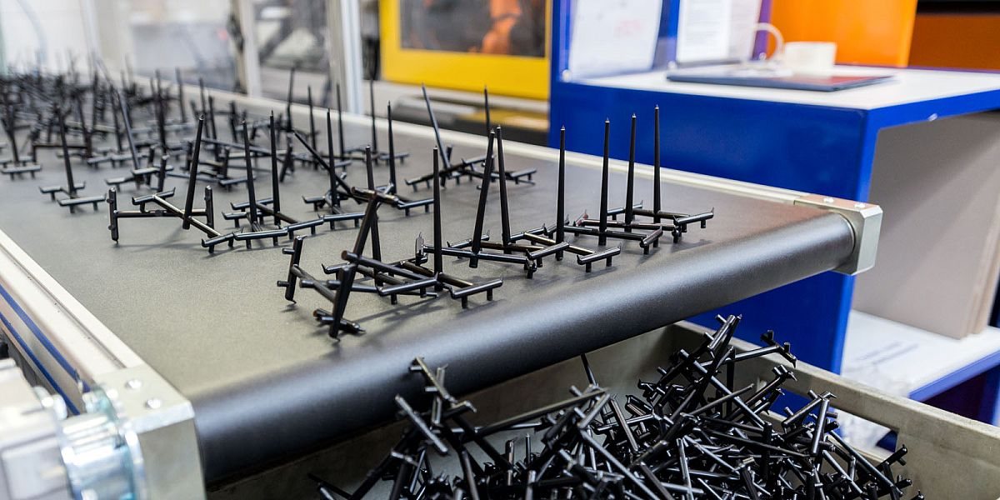

선정 이유: 반복되는 검은 가지형 조각과 포집 공정이 보여 공정 내 재투입 조건·시험자료 질문을 구성할 수 있다.

역할: production runners: conditional return to process

보이는 관찰: Repeated black branching frames stand on a conveyor and collect below it.

원본: `01_plastic_100.zip` / `폐플라스틱/plastic_020.jpg`. 원본 SHA-256: `bcdc3845b9d76312fdf7aab4fae40a894effd2aebc816138a57506ec6832b93b`.

출처 제목은 원문 주장이다: In-Process Recycling of TPE Sprues. 출처: `https://www.kraiburg-tpe.com/en/tpe-basics-process-recycling`.

재사용허락/촬영진위: 미확인. No image reuse license established in extracted primary text and inspected HTML matches.

### 03 plastic_097

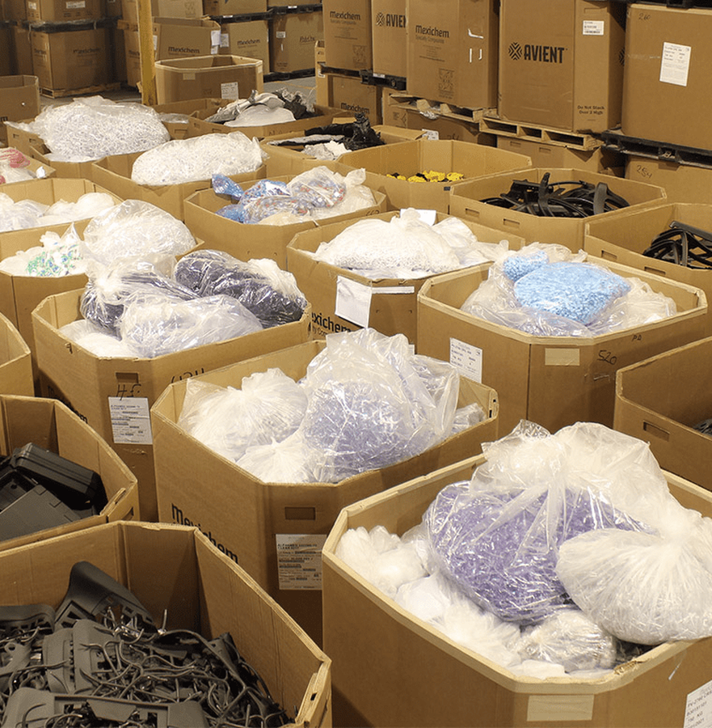

선정 이유: 여러 상자·봉투로 나눈 수거 상태가 보여 상자 라벨과 실제 배치·수지 일치 여부를 확인하기 좋다.

역할: source-separated collection: verify bin identities

보이는 관찰: Many open cardboard bins contain separately bagged pale, blue and purple fragments plus black frames.

원본: `01_plastic_100.zip` / `폐플라스틱/plastic_097.png`. 원본 SHA-256: `0fe72de3493c9ede3abedadce483d8e1d233a77654f62dea77bd26db9b048677`.

출처 제목은 원문 주장이다: Plastic Scrap Storage in Recycling Facility. 출처: `https://valleyplasticsrecycling.com/services`.

재사용허락/촬영진위: 미확인. Page HTML says copyright 2021 and all rights reserved; no photo reuse grant established.

### 04 plastic_039

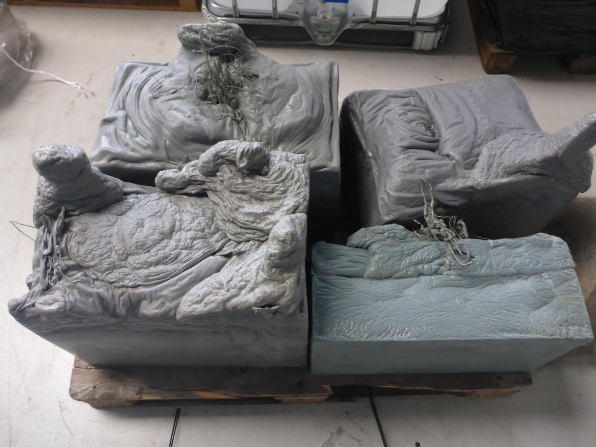

선정 이유: 주름과 가는 끈이 있는 회색 덩어리는 퍼지·시동 이력 질문에 적합하며 열이력과 조성은 사진으로 확정하지 않는다.

역할: startup or purge masses: hold for history

보이는 관찰: Gray block-like masses have rippled tops, raised necks and thin strands on pallets.

원본: `01_plastic_100.zip` / `폐플라스틱/plastic_039.jpg`. 원본 SHA-256: `c694ffe65d36882bc80bfea66405ca448e0ec294788fe031652e415d87daf688`.

출처 제목은 원문 주장이다: Post-Industrial Plastic Clumps. 출처: `https://vecoplan.com/de/material/kunststoffe-post-industrial/anfahrbrocken-und-klumpen`.

재사용허락/촬영진위: 미확인. No image reuse license established in extracted primary text and inspected HTML matches.

### 05 plastic_025

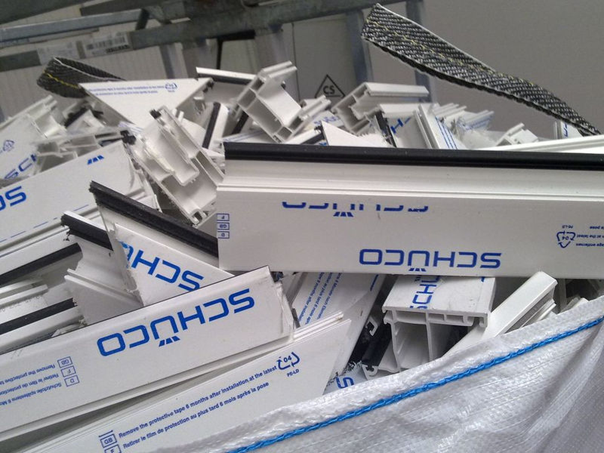

선정 이유: 보호필름·인쇄·검은 띠가 붙은 프로파일 조각으로 기재와 부착물 분리 질문을 만든다.

역할: profile offcuts: films and seals separation

보이는 관찰: White profile cuttings with protective printed film sit in a woven sack.

원본: `01_plastic_100.zip` / `폐플라스틱/plastic_025.jpg`. 원본 SHA-256: `cb694b099969301ff9121c829ced02ce1b69ec996265ae7a9ca80711afe2cc2a`.

출처 제목은 원문 주장이다: Schüco PVC Frame Offcuts. 출처: `https://www.evmh.be/products.html`.

재사용허락/촬영진위: 미확인. HTML copyright metadata names evmh srl; no photo reuse grant established.

### 06 plastic_041

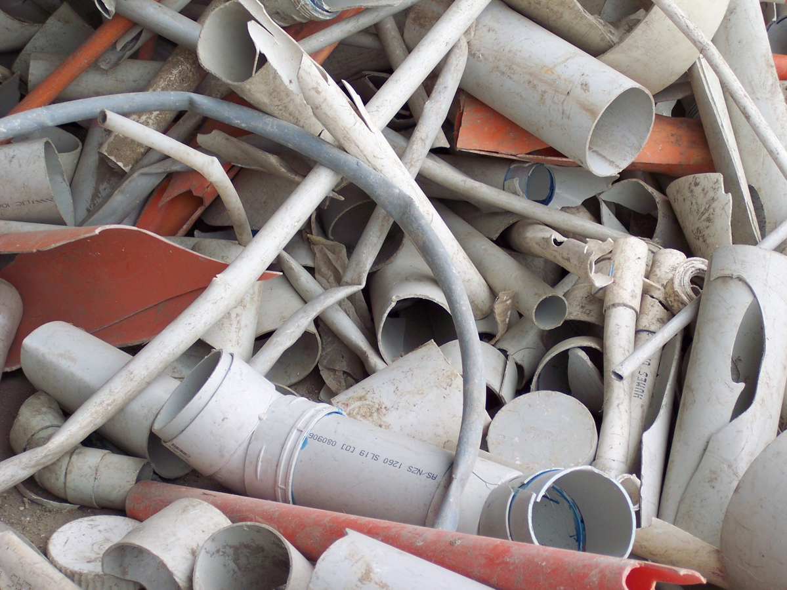

선정 이유: 여러 색·직경의 절단 파이프와 표면 흔적이 있어 이전 용도·잔류물·부착물·표기 확인을 요구한다.

역할: pipe offcuts: hold for service and residue facts

보이는 관찰: Overlapping white, gray and orange pipe pieces show broken edges and surface dirt-like marks.

원본: `01_plastic_100.zip` / `폐플라스틱/plastic_041.jpg`. 원본 SHA-256: `5e53b6566fae6e34dcb7d9da67bd3e443b708e99d3d38d5491284cdb0f2a87d6`.

출처 제목은 원문 주장이다: PVC Pipe Off‑Cuts Pile. 출처: `https://constructionplasticsrecyclingscheme.com.au/locations`.

재사용허락/촬영진위: 미확인. No image reuse license established in extracted primary text and inspected HTML matches.

### 07 plastic_085

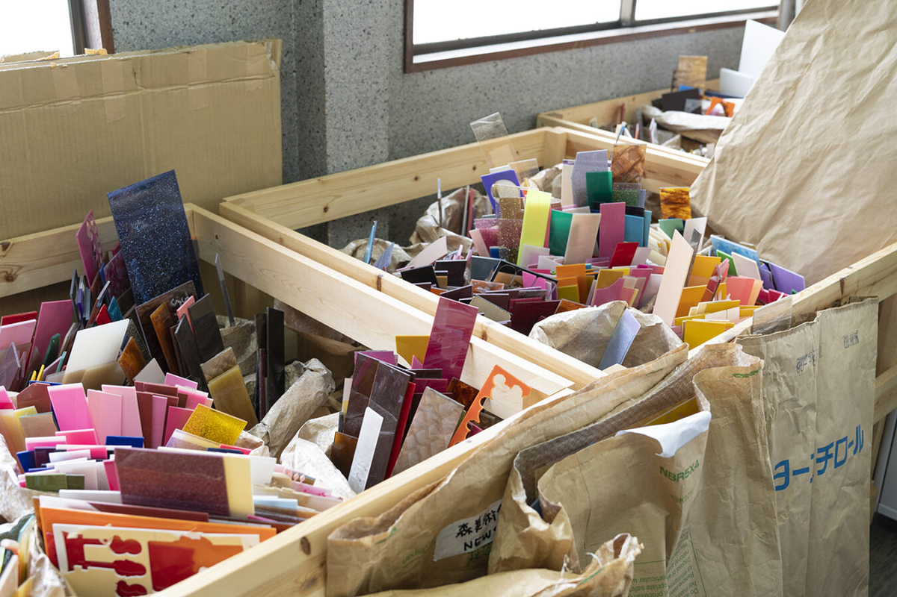

선정 이유: 다양한 색과 표면의 판재 자투리를 보며 기재·코팅·보호필름 및 재사용 가능한 치수 구분을 묻는다.

역할: sheet offcuts: separate substrates and coatings

보이는 관찰: Large open sacks contain many colored rectangular sheet offcuts in a workshop.

원본: `01_plastic_100.zip` / `폐플라스틱/plastic_085.jpg`. 원본 SHA-256: `b2fc66ba831d0f10ba231088b8e79cf9f2fc0367463ab7d1b258d83eb8f4f9fd`.

출처 제목은 원문 주장이다: Upcycled Acrylic Scrap Storage. 출처: `https://www.eco-tsuku.net/column/post9995/`.

재사용허락/촬영진위: 미확인. No image reuse license established in extracted primary text and inspected HTML matches.

### 08 plastic_099

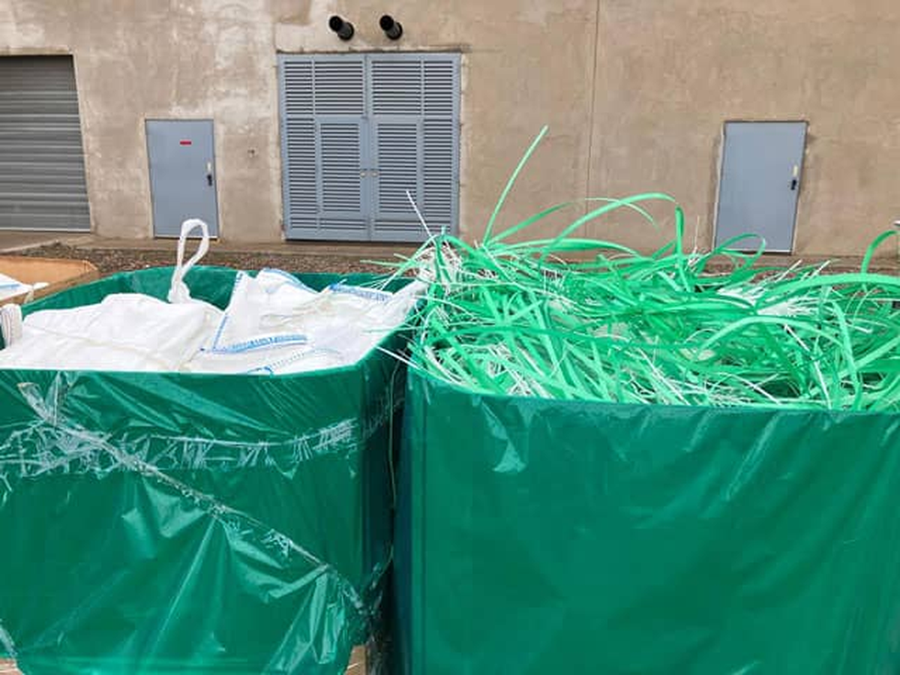

선정 이유: 흰 봉투류와 녹색 띠가 다른 통에 담겨 있어 연질 포장재·밴드 분리와 이전 접촉 이력을 확인한다.

역할: flexible packaging and strapping: contact-history questions

보이는 관찰: Two green-lined bins separate pale bag-like material from long green strapping-like strips.

원본: `01_plastic_100.zip` / `폐플라스틱/plastic_099.jpg`. 원본 SHA-256: `a886cdcf3355474fce00c228b03173c874a29ef0262e8b05d6cc6efab81ebdea`.

출처 제목은 원문 주장이다: Organized Waste Storage Bins. 출처: `https://www.simplot.com/company/news/creative-approach-in-argentina-addresses-waste-management-challenges`.

재사용허락/촬영진위: 미확인. No image reuse license established in extracted primary text and inspected HTML matches.

### 09 packaging_096

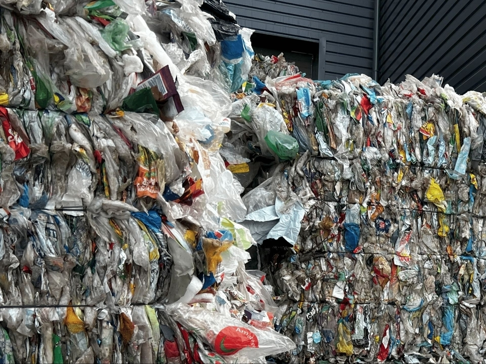

선정 이유: 인쇄 포장과 투명 필름이 한 압축물에 섞여 있어 층·잉크·접착제·내용물 이력 미확인 보류를 다룬다.

역할: printed mixed-film hold

보이는 관찰: Clear wrinkled film, colored printed pouches and labels are compressed together in tied bales against a gray wall.

원본: `04_packaging_100.zip` / `폐포장재/packaging_096.jpg`. 원본 SHA-256: `aebc7048e6ec594f45ca15e20a90eda5f170f638ed3d86e88a174d469a9ba67d`.

출처 제목은 원문 주장이다: Plastic Film Bales Ready for Recycling. 출처: `https://www.recovery-worldwide.com/en/news/pioneering-circularity-in-plastic-film-recycling-how-ab-plasta-and-tomra-are-setting-new-standards-in-the-baltics-4302867.html`.

재사용허락/촬영진위: 미확인. unknown; credit is not a reuse grant

### 10 packaging_090

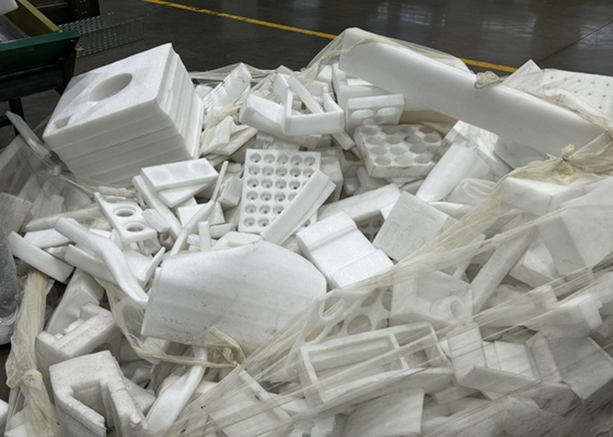

선정 이유: 흰 성형 완충재와 얇은 시트·끈이 함께 보여 발포체 계열과 부착물 확인을 요청한다.

역할: foam-family and mixed-form hold

보이는 관찰: A pile combines white molded inserts, thin flexible pale sheets and translucent straps/wrap inside a lined container.

원본: `04_packaging_100.zip` / `폐포장재/packaging_090.jpg`. 원본 SHA-256: `a5298b9c220ba0668b8b9c4b0130d609ac17a58b4f2e12ce7761dde784738d99`.

출처 제목은 원문 주장이다: EPE Foam Packaging Waste Accumulation. 출처: `https://www.intcorecycling.com/greenmax-foam-recycling-machine-epe-recycling-solution-for-electronics-manufacturers.html`.

재사용허락/촬영진위: 미확인. All rights reserved footer; affirmative reuse permission unknown

### 11 plastic_015

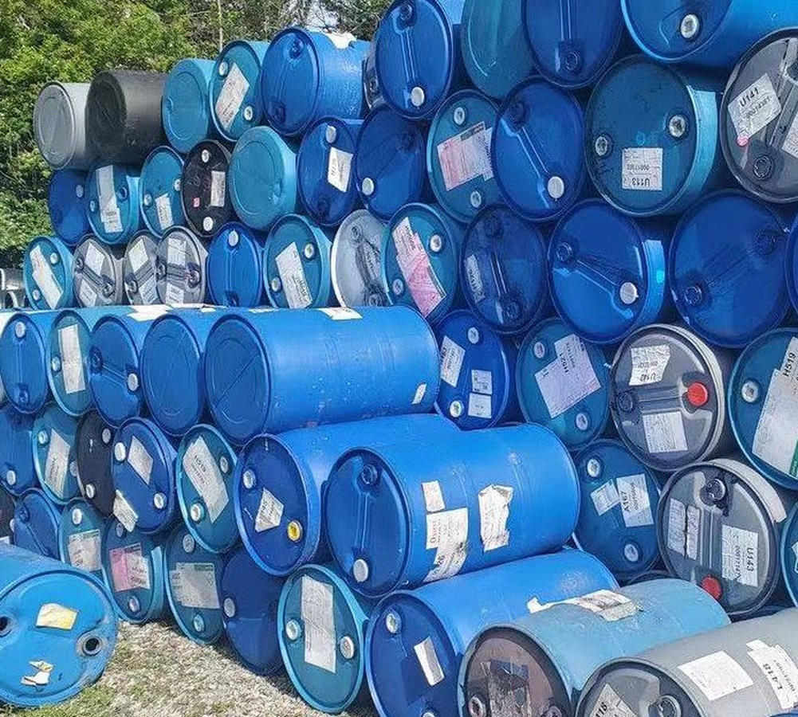

선정 이유: 라벨이 남은 파란 드럼은 이전 내용물·SDS·배출·세척 기록을 묻는 중요한 보류 사례다.

역할: drums: hold for prior contents and cleaning records

보이는 관찰: Rows of mostly blue drums with caps and many paper labels are stacked outdoors.

원본: `01_plastic_100.zip` / `폐플라스틱/plastic_015.jpg`. 원본 SHA-256: `a202945fcf1dba504ad15736cf835446a0d4959ffc6c1430275a6763ed9c6e3d`.

출처 제목은 원문 주장이다: HDPE Blue Drums Inventory. 출처: `https://www.fukutomi.com/product-page/hdpe-blue-drums`.

재사용허락/촬영진위: 미확인. No image reuse license established in extracted primary text and inspected HTML matches.

### 12 packaging_021

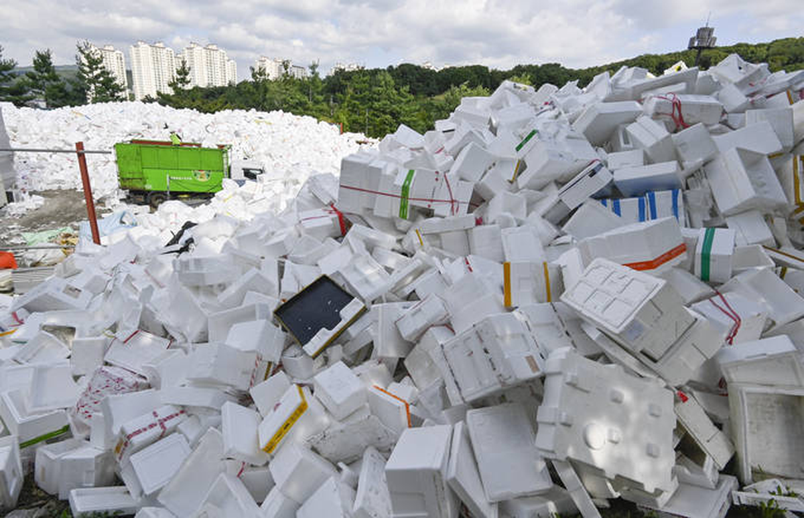

선정 이유: 테이프·검은 판이 붙은 흰 완충재 더미로 부착물 분리와 수지 확인 질문을 만든다.

역할: foam packaging attachment hold

보이는 관찰: An outdoor heap of white molded boxes and inserts bears red/green tape and a black panel; green container behind.

원본: `04_packaging_100.zip` / `폐포장재/packaging_021.jpg`. 원본 SHA-256: `14aad2a10a37cb7f4e8e4dda6410f8dfac299a046eef39d32669916f4fcfb075`.

출처 제목은 원문 주장이다: Styrofoam Packaging Waste Piled High. 출처: `https://www.kgnews.co.kr/news/article.html?no=668267`.

재사용허락/촬영진위: 미확인. Publisher prohibits unauthorized republication/redistribution; affirmative permission unknown

### 13 packaging_013

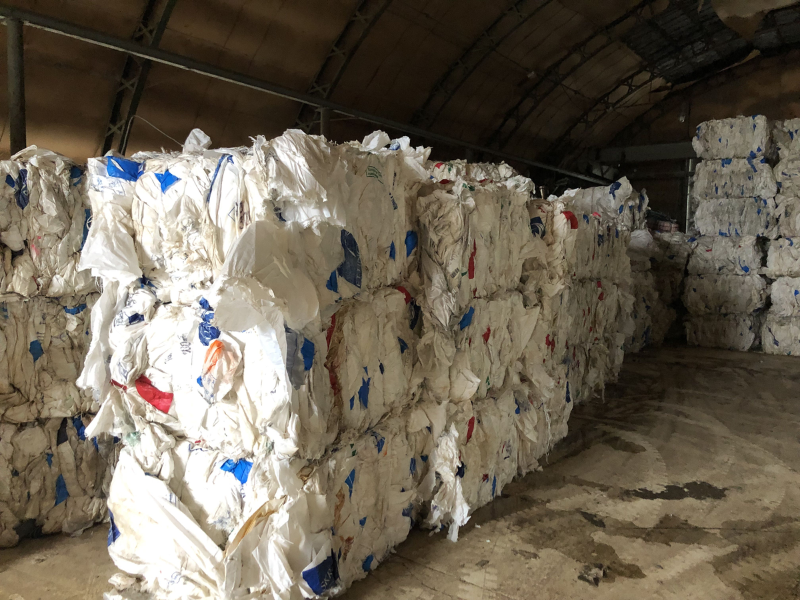

선정 이유: 인쇄와 해진 가장자리가 보이는 압축 자루로 라이너·코팅·이전 내용물 이력을 묻는다.

역할: printed sack liner/contact hold

보이는 관찰: White sack-like folded material with blue/red printing and frayed edges fills indoor bale stacks.

원본: `04_packaging_100.zip` / `폐포장재/packaging_013.jpg`. 원본 SHA-256: `1b2cf34c5ba15ce00ec9a56c5d24399401d8300a392db2d74dccba084cdbfd1a`.

출처 제목은 원문 주장이다: Warehouse Storage of PP Big Bag Scrap. 출처: `https://www.cyrkl.com/en/materials/305bee4f-2911-45fb-b4bc-73248ef203fb`.

재사용허락/촬영진위: 미확인. unknown; no image-specific reuse grant established

### 14 packaging_007

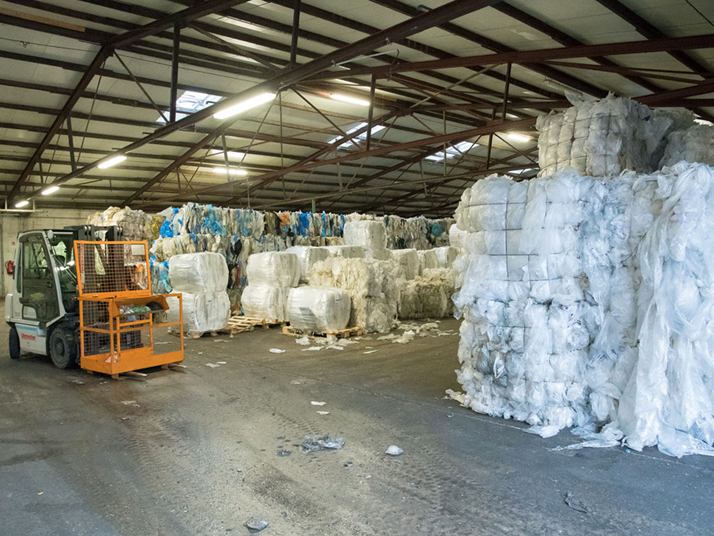

선정 이유: 반투명 필름 압축물의 보관 상태를 비교하되 투명도나 흰색을 단일수지·청결 증거로 쓰지 않는다.

역할: film-storage missing-facts case

보이는 관찰: Translucent white film-like folds fill strapped bales; colored bales sit behind and an orange platform is parked left.

원본: `04_packaging_100.zip` / `폐포장재/packaging_007.jpg`. 원본 SHA-256: `401344b2a083d35a981429c0311bd0747ce0f382039e6aa01ce17a835ec4be63`.

출처 제목은 원문 주장이다: Plastic Film Storage Warehouse. 출처: `https://www.s-d-kunststoffrecycling.de/en/`.

재사용허락/촬영진위: 미확인. unknown; no image-specific reuse grant established

### 15 packaging_048

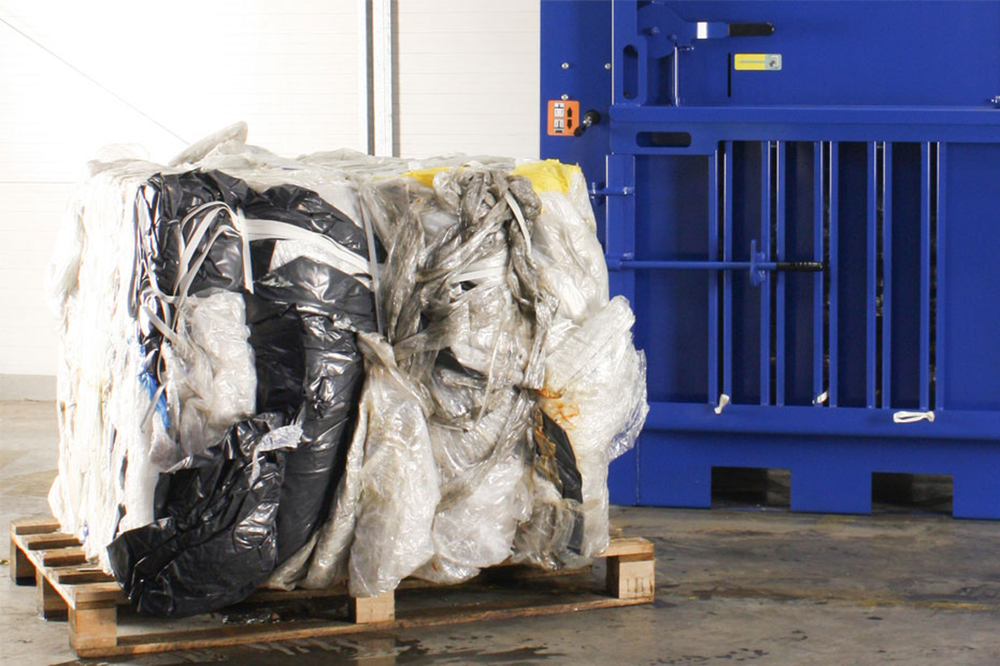

선정 이유: 검은 시트·투명 필름·띠가 한 압축물에 있어 색·형태별 분리와 상용성 미확인을 드러낸다.

역할: black/clear film segregation hold

보이는 관찰: One bale contains black sheets, clear wrinkled film, pale straps and yellow patches beside a blue press.

원본: `04_packaging_100.zip` / `폐포장재/packaging_048.jpg`. 원본 SHA-256: `46febe735b0b78172909688f03070af2cfe5987504bf5b54269dcec7687e4008`.

출처 제목은 원문 주장이다: MACFAB 150 Vertical Baler with Plastic Film Bale. 출처: `https://www.macfab.com/150-baler.html`.

재사용허락/촬영진위: 미확인. unknown; no open image license observed in returned page text

### 16 plastic_058

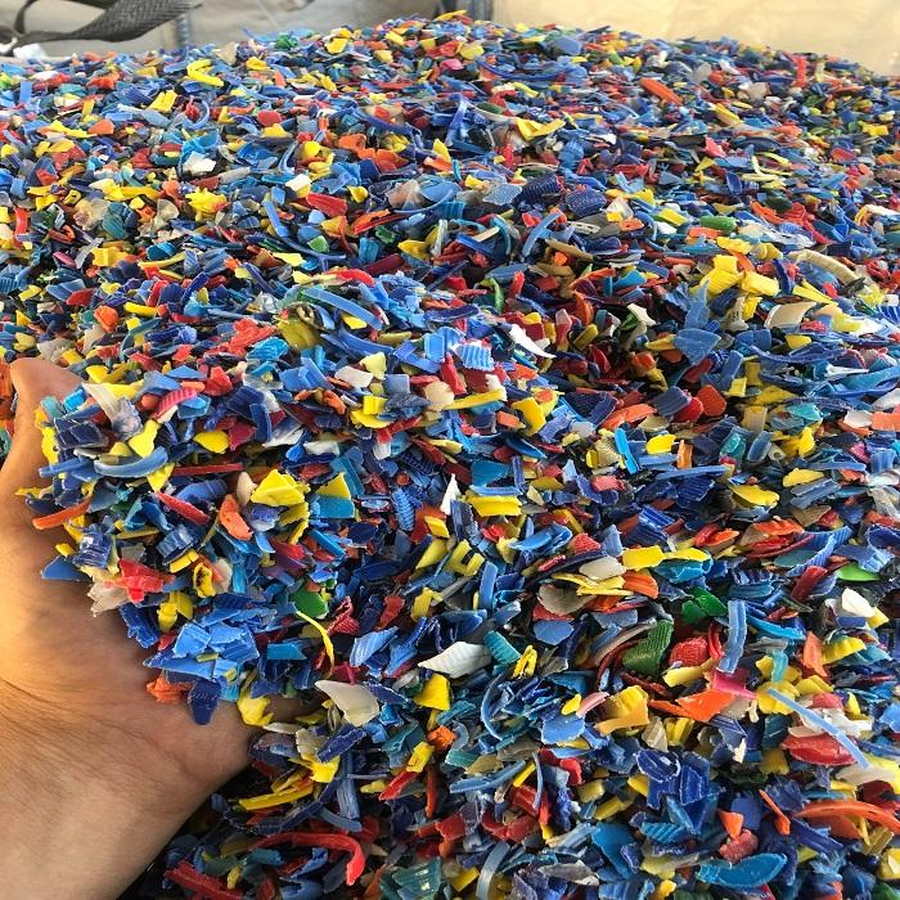

선정 이유: 다색 파쇄 조각은 색·입도만으로 수지를 맞히지 않고 성분·등급 자료를 요구하는 사례다.

역할: size-reduced mixture: hold for composition testing

보이는 관찰: Hand supports a mound of bright blue, yellow, red and green angular flakes.

원본: `01_plastic_100.zip` / `폐플라스틱/plastic_058.jpg`. 원본 SHA-256: `510dbc4aad449aec57ec8f7b5c73f992ddde487e7974ca9e62eeccd13b6a826b`.

출처 제목은 원문 주장이다: Multicolored HDPE Regrind Mix. 출처: `https://www.alibaba.com/showroom/hdpe-regrind-mix-color.html`.

재사용허락/촬영진위: 미확인. No image reuse license established in extracted primary text and inspected HTML matches.

### 17 plastic_076

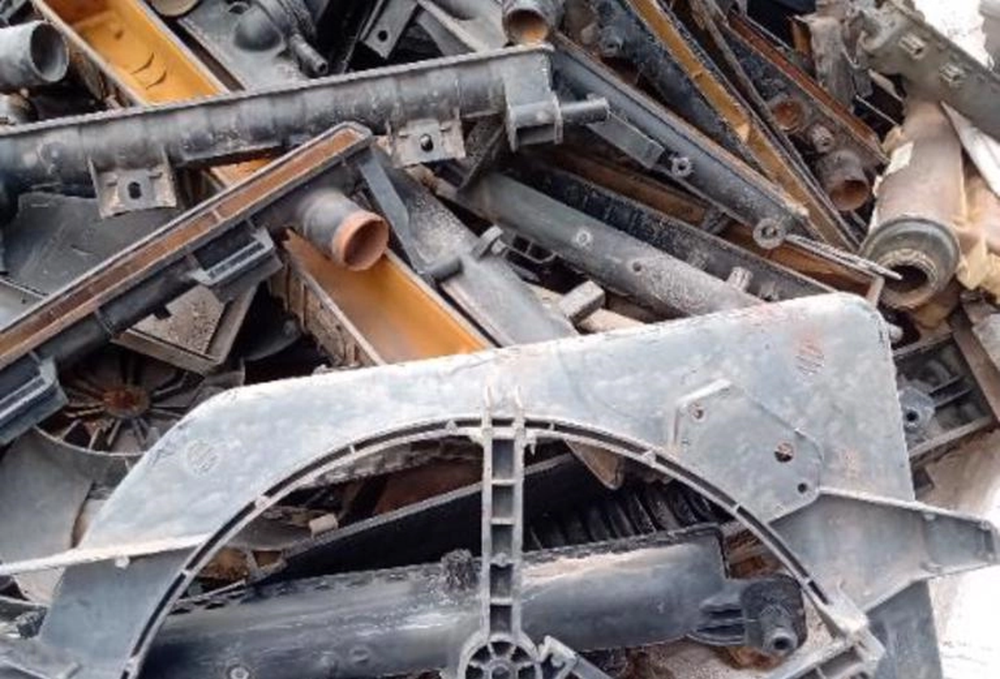

선정 이유: 관구·리브가 있는 회색 조립품은 해체·이전 용도·잔류 이력 질문에 적합하지만 원 출처 상세글은 사라졌다.

역할: automotive assemblies: hold for dismantling and prior service

보이는 관찰: Bin of dusty gray elongated molded pieces includes pipe openings and ribs.

원본: `01_plastic_100.zip` / `폐플라스틱/plastic_076.webp`. 원본 SHA-256: `f5622bb0dc889ef68d2b73e761aa2ad121587c01ea39985f7a1685fd8e9bac44`.

출처 제목은 원문 주장이다: Plastic Radiator Scrap for Recycling. 출처: `https://www.mfrural.com.br/detalhe/639595/compramos-sucata-plastica-de-radiadores-nylon-6-66-pa6-6`.

재사용허락/촬영진위: 미확인. unknown; no image-specific reuse grant established

### 18 plastic_096

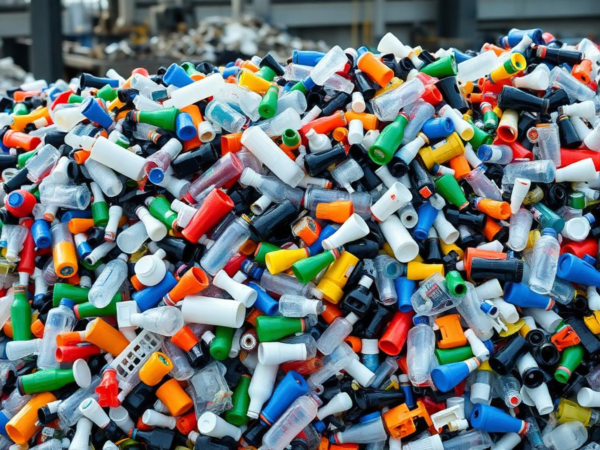

선정 이유: 작은 병·튜브·마개가 섞인 형태로 이전 내용물·라벨 분리를 묻되 현장 진위나 공급자 성능 주장을 검증값으로 쓰지 않는다.

역할: mixed packaging: hold for contact and contents history

보이는 관찰: Heap of colorful small bottles, tubes and closures fills the frame.

원본: `01_plastic_100.zip` / `폐플라스틱/plastic_096.jpg`. 원본 SHA-256: `054b9b2c57b63ec73e94917285f03238a5c66f98455d809d3843b7ce7faac190`.

출처 제목은 원문 주장이다: Sorted Hard Plastic Waste for Eco-Aggregate Production. 출처: `https://transmutation.com.au/resin8`.

재사용허락/촬영진위: 미확인. unknown; no image-specific reuse grant established

### 19 packaging_041

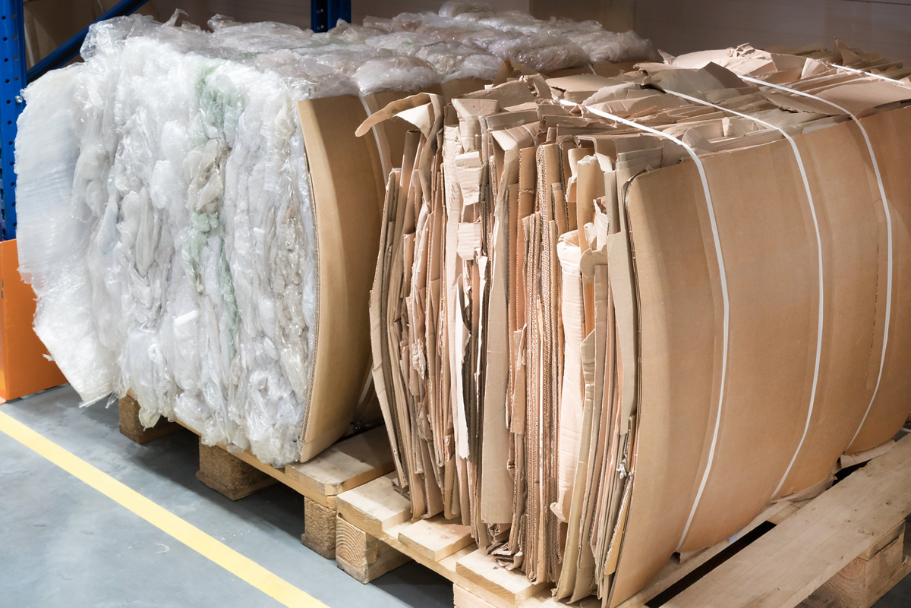

선정 이유: 골판지와 투명 완충필름이 나란히 있어 포장재라는 이유로 비플라스틱을 같은 흐름에 합치지 않는 경계 사례다.

역할: plastic/nonplastic stream separation contrast

보이는 관찰: A corrugated cardboard bale sits beside translucent bubble/film-like material on a separate pallet.

원본: `04_packaging_100.zip` / `폐포장재/packaging_041.jpg`. 원본 SHA-256: `22d5c175a7ddc18e00ca87a5a62e27b20123639a4051b990b22c50ab944450e3`.

출처 제목은 원문 주장이다: Warehouse Recycling Bales. 출처: `https://www.olympicpalletcorp.com/products/p/commercial-recycling`.

재사용허락/촬영진위: 미확인. All rights reserved footer; affirmative reuse permission unknown

### 20 plastic_028

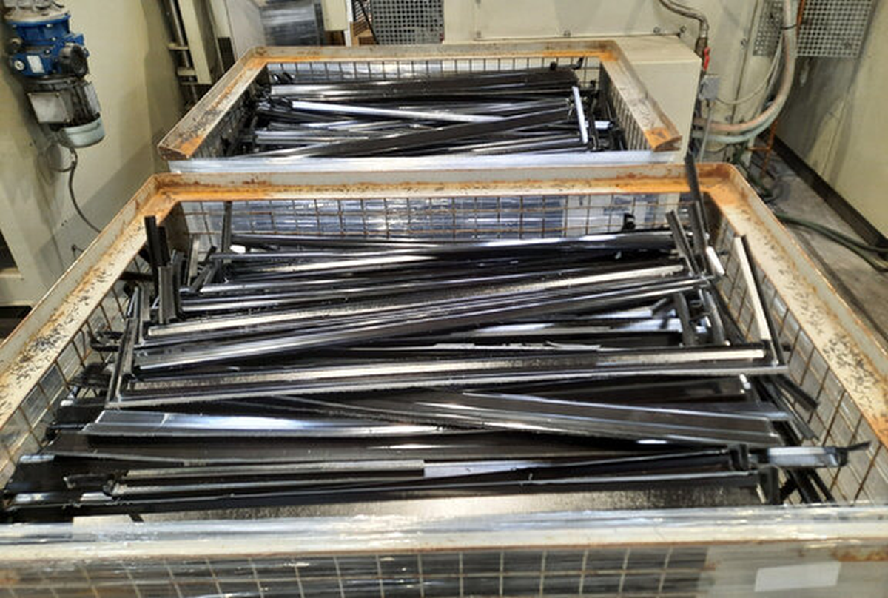

선정 이유: 반짝이는 긴 띠의 재질을 화상만으로 확정할 수 없어 공급자 조성·층 구조·기재 명세를 요구하는 보류 사례로 추가했다.

역할: composition/layer/scope-unknown manufacturing-strip hold

보이는 관찰: Two wire cages hold long glossy black and silver-edged strips.

원본: `01_plastic_100.zip` / `폐플라스틱/plastic_028.jpg`. 원본 SHA-256: `86008d0038e4493c45b67855779db9c14387d27d4c266a7384ef50cb6b222170`.

출처 제목은 원문 주장이다: Plastic Extrusion Bins. 출처: `https://www.fm-kunststofftechnik.de/kompetenzen/nachhaltigkeit`.

재사용허락/촬영진위: 미확인. unknown; no image-specific reuse grant established

### 21 metal_028

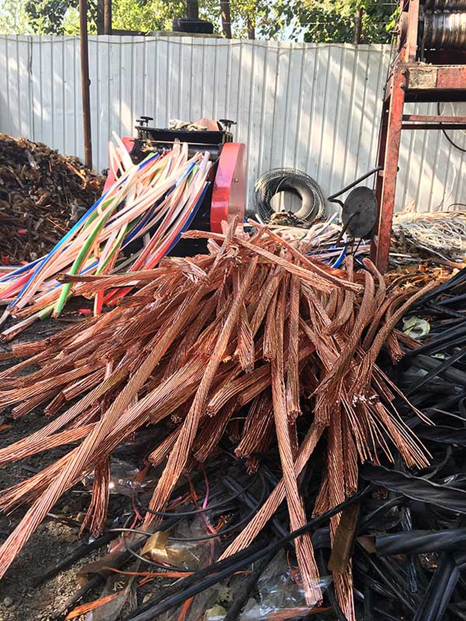

선정 이유: 피복처럼 보이는 색 띠와 노출된 붉은 가닥이 함께 있어 피복·금속 분리와 조성 확인을 묻는 경계 사례다.

역할: mixed-cable-composition-separation-hold

보이는 관찰: Reddish exposed fine-strand bundles lie in front of multicolored smooth cable-like lengths; black lengths below.

원본: `02_metal_100.zip` / `금속스크랩/metal_028.jpg`. 원본 SHA-256: `bbe9a7509e395402819a7f8078b8d0e29c8332831572ec71680d3c546a23f5fd`.

출처 제목은 원문 주장이다: Copper Cable Recycling Operation. 출처: `https://metallolomgroup.ru/`.

재사용허락/촬영진위: 미확인. unknown

### 22 rubber_090

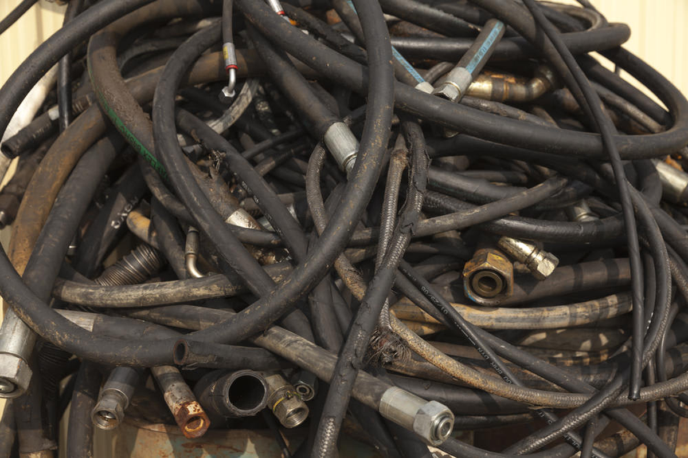

선정 이유: 금속 연결구가 남은 검은 호스는 해체와 이전 서비스·유체 접촉 이력을 요구하는 조립품 보류 사례다.

역할: hold-example

보이는 관찰: A larger-original view shows tangled used hoses with metal couplings, cut ends, exposed reinforcement and visibly varied condition.

원본: `06_rubber_100.zip` / `폐고무/rubber_090.jpg`. 원본 SHA-256: `f04198f56d80a93e2f50e9aa83af6e699076ac5760a6f72d29a671a26fc315f3`.

출처 제목은 원문 주장이다: Used Automotive Hoses. 출처: `https://www.yourmechanic.com/article/what-material-for-car-hoses-is-the-strongest-and-most-durable`.

재사용허락/촬영진위: 미확인. unknown

### 23 wood_072

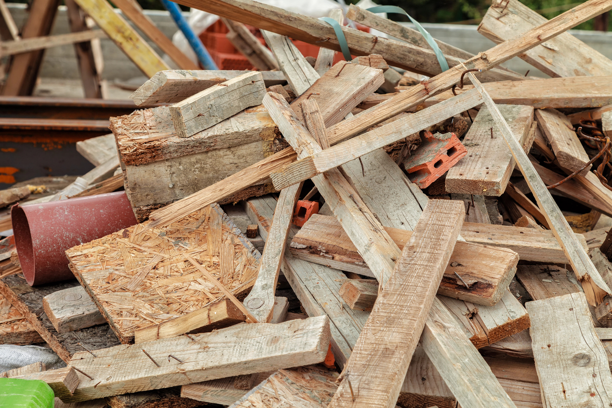

선정 이유: 목재형 판·못·띠·벽돌형 조각이 섞여 있어 혼합물과 부착물을 확인하고 플라스틱 단일 흐름 판단을 보류한다.

역할: missing-facts-hold

보이는 관찰: A close pile contains rough boards, a flake-textured sheet, protruding bent fasteners, red hollow brick-like pieces, a pipe-like section and a green strap.

원본: `03_wood_100.zip` / `폐목재/wood_072.jpg`. 원본 SHA-256: `bbd08f3bc1e1d9e56d956ec4a9f21a0e8bff138b2e7dc26c147c3009bbd6dd92`.

출처 제목은 원문 주장이다: Construction Site Wood Debris. 출처: `https://www.capeb.fr/actualites/arrete-rep-une-avancee-majeure-pour-une-gestion-responsable-des-dechets-de-chantier-attendue-par-les-entreprises-artisanales-du-batiment-et-portee-par-la-capeb-il2veu`.

재사용허락/촬영진위: 미확인. unknown

### 24 sludge_034

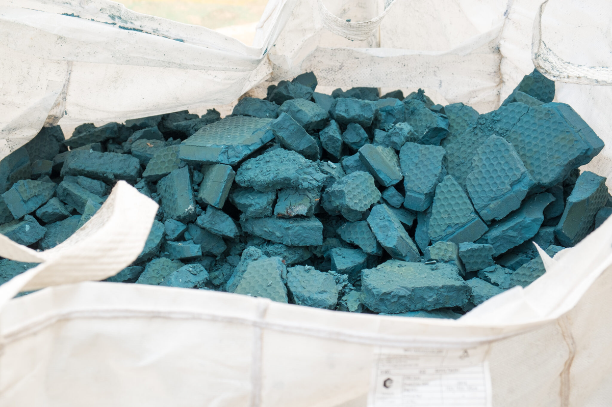

선정 이유: 푸른 성형 케이크처럼 보이는 조각이 자루에 있어 색과 용기만으로 플라스틱으로 분류하지 않는 음성·보류 사례다.

역할: out-of-scope material contrast

보이는 관찰: Blue broken cakes with circular impressions fill a white woven bulk bag; label blurred.

원본: `05_sludge_100.zip` / `공정오니/sludge_034.jpg`. 원본 SHA-256: `e78ee7d9c0421926d5cccad9e0b085dcb7c523464aa479e50a374214212a333a`.

출처 제목은 원문 주장이다: Blue Filter Cake in Bulk Bag. 출처: `https://www.econindustries.com/applications/filter-cake`.

재사용허락/촬영진위: 미확인. unknown; no image-specific reuse grant established

### 25 construction_079

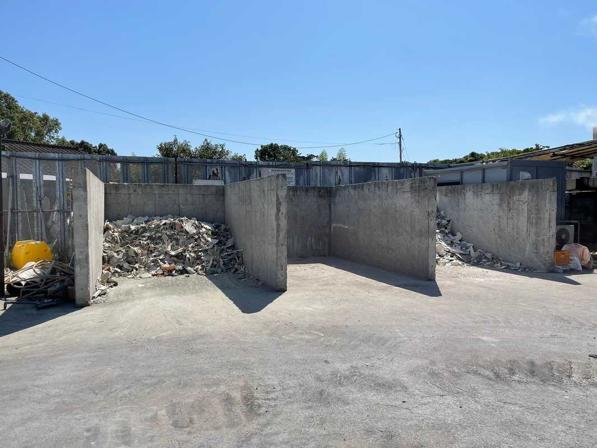

선정 이유: 벽으로 나눈 피트의 혼합 조각은 원문상 폐플라스틱·잔재 분별 구역이지만 개별 조성을 확인할 수 없는 혼합 흐름 보류다.

역할: hold example: mixed bay

보이는 관찰: Concrete-walled sorting bays contain a mixed heap with visible cables, pipes, fabric or sheet-like items and a yellow object.

원본: `07_construction_100.zip` / `건설폐기물/construction_079.jpg`. 원본 SHA-256: `0f884f47d0b0788edb08b27763984434c864f116c67912fcefae510a17b9c0a8`.

출처 제목은 원문 주장이다: Industrial Waste Sorting Pits. 출처: `https://www.kk-bisou.co.jp/business/`.

재사용허락/촬영진위: 미확인. unknown; no image-specific reuse grant established

### 26 metal_001

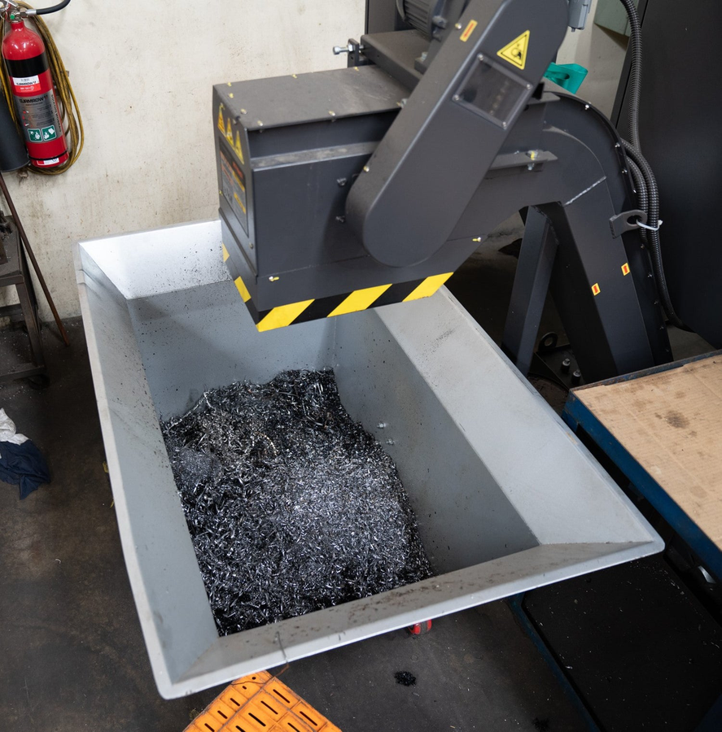

선정 이유: 기계 아래 수거통의 가는 금속형 조각은 비플라스틱 대비와 공정·절삭유 접촉 이력 질문을 제공한다.

역할: nonplastic-process-contact-hold

보이는 관찰: Gray chute above a pale wheeled bin of curled silver-gray fragments; extinguisher on wall.

원본: `02_metal_100.zip` / `금속스크랩/metal_001.jpg`. 원본 SHA-256: `bcbeabfc0e072eb3228d21d58d703995f67b204cde2ce1c483bf05643d942f58`.

출처 제목은 원문 주장이다: CNC Machine Swarf Collection. 출처: `https://swarfbins.com.au/`.

재사용허락/촬영진위: 미확인. unknown

### 27 wood_001

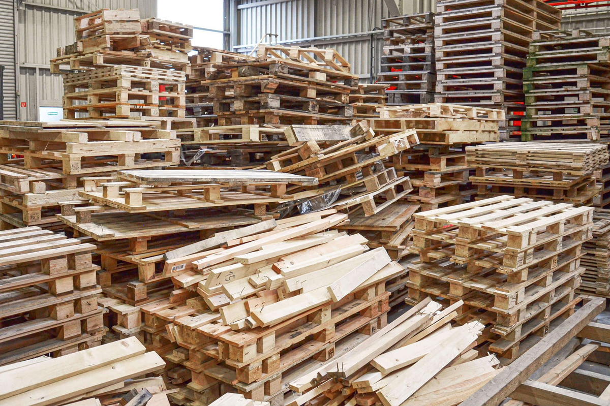

선정 이유: 적재 팔레트는 포장·운반 자재가 곧 폐플라스틱이라는 일반화를 막는 명확한 비플라스틱 대비다.

역할: explicit-nonplastic-contrast

보이는 관찰: Indoor stacks of pale and weathered slatted pallets; loose boards in front and small labels on blocks.

원본: `03_wood_100.zip` / `폐목재/wood_001.jpg`. 원본 SHA-256: `11c9a35489b224afa768676d098700f58406d857f288fcd0132fdd19351fb85e`.

출처 제목은 원문 주장이다: Wooden Pallet Storage and Recycling Preparation. 출처: `https://weima.com/en/shredding-and-recycling-pallets/`.

재사용허락/촬영진위: 미확인. No open reuse license established; disclaimer reserves site content rights and restricts commercial reuse or distribution.

### 28 sludge_010

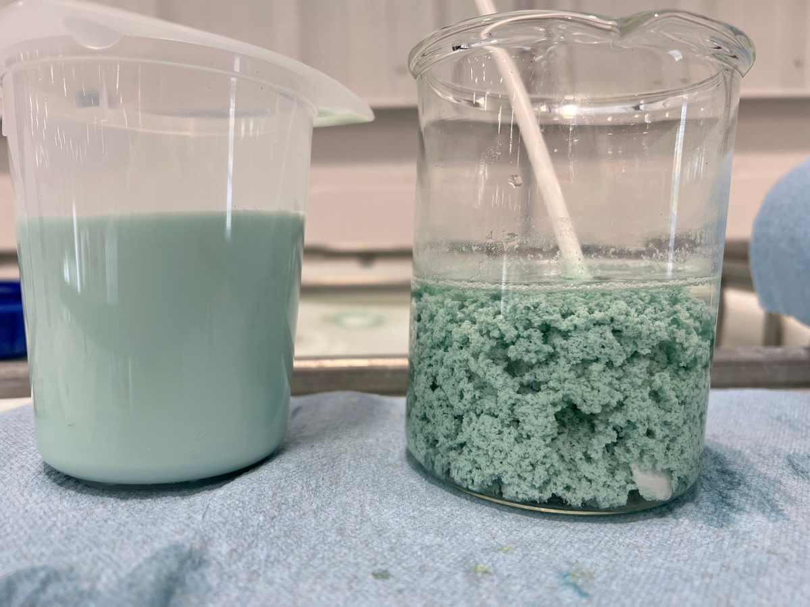

선정 이유: 두 컵의 액체·덩어리 상태 차이는 처리 성공·안전성을 사진으로 확정하지 않고 시험조건·성분 자료를 요구하는 보류다.

역할: hold-and-missing-facts contrast

보이는 관찰: Two cups show pale green liquid and coarse green flocs under clearer liquid; white stirring rod.

원본: `05_sludge_100.zip` / `공정오니/sludge_010.jpg`. 원본 SHA-256: `571c35fd670bb277f37e4cb56babfa4e45f2a572192a1688e42c703ad2ff60c7`.

출처 제목은 원문 주장이다: Paint Dewatering Test. 출처: `https://www.beckart.com/paints-coating`.

재사용허락/촬영진위: 미확인. unknown; no image-specific reuse grant established

### 29 rubber_097

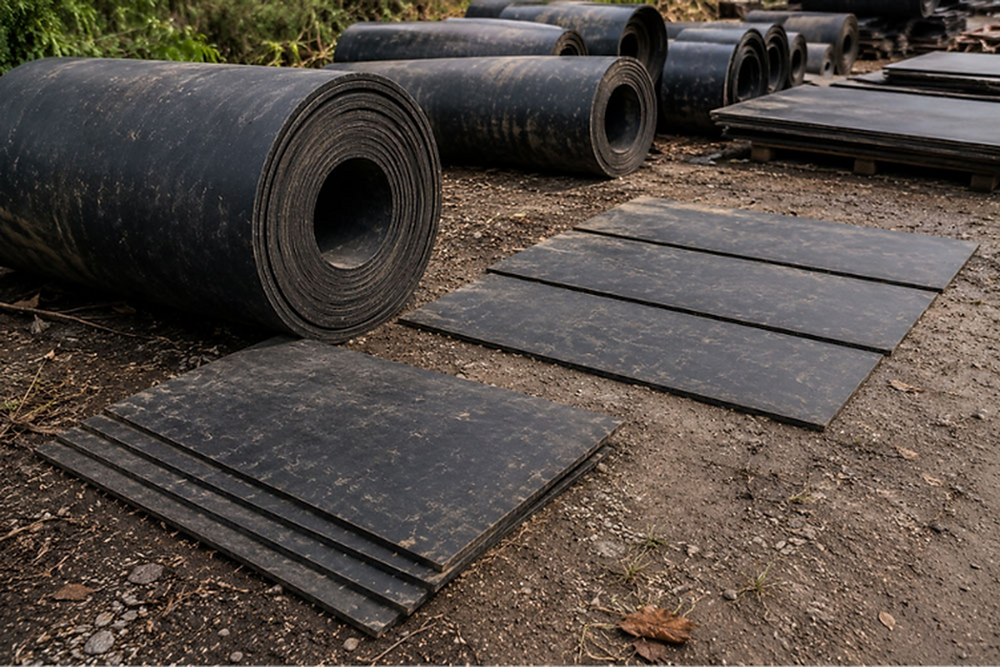

선정 이유: 두꺼운 롤과 절단 매트 형태는 재사용 조건의 치수·상태·보강재·이전 접촉 이력을 묻는 비플라스틱 조건부 사례다.

역할: conditional-route-example

보이는 관찰: Large used conveyor-belt rolls and rectangular cut mats are laid out on bare ground with weathered surfaces.

원본: `06_rubber_100.zip` / `폐고무/rubber_097.png`. 원본 SHA-256: `12d32d4d64b24e5c963820fd42a2ee3fb66a01e5ba9fa82fa5b083d11b9effca`.

출처 제목은 원문 주장이다: Repurposed Conveyor Belt Mats. 출처: `https://www.usbelt.com/post/how-used-conveyor-belt-is-repurposed-into-mats-and-liners`.

재사용허락/촬영진위: 미확인. unknown; no image-specific reuse grant established

### 30 metal_084

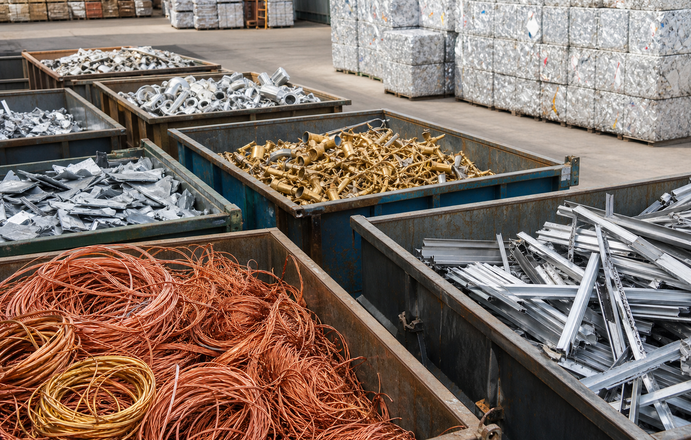

선정 이유: 서로 다른 색·형태가 별도 통에 놓여 있어 분리 외관이 재질 순도나 수용 적합성의 증거가 아님을 비교한다.

역할: sorting-appearance-contrast

보이는 관찰: Separate open bins hold reddish strands, gold-colored fittings, gray sheet pieces, and silver profiles; rectangular bales behind.

원본: `02_metal_100.zip` / `금속스크랩/metal_084.png`. 원본 SHA-256: `a5ea9ea5639acbfe63945bb9d82a43e837f474751caf3917fb6e87dff1b022d4`.

출처 제목은 원문 주장이다: Nonferrous Scrap Sorting Facility. 출처: `https://www.polylink.ca/`.

재사용허락/촬영진위: 미확인. unknown

## 평가와 실제 실행의 경계

화학성분·공정·이전 내용물/접촉·SDS·세척·배치 분리·물량/지역·수용 조건은 사진 밖의 근거가 필요하다. 자료가 없으면 질문/보류로 남긴다. 실제 입력은 알려진 사실과 명시된 미상을 사용하며 출처 제목을 입력 정답으로 복사하지 않는다.

현재 이 묶음은 선별과 출처 조사 결과다. 실제 모델 호출·request ID/usage·사진 전송 SHA/revision·현장 성능·독립 사람 라벨을 이 자료만으로 완료했다고 주장하지 않는다. 최종10장과 실행 증거는 별도 기록한다.
